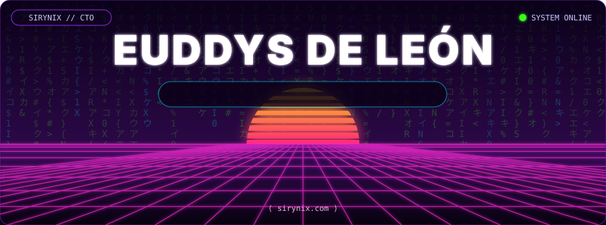
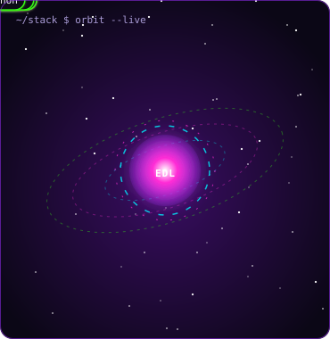

<table>
  <tr>
    <td valign="top"></td>
    <td valign="top"></td>
  </tr>
</table>

Arte generado con Python · se reconstruye cada día con GitHub Actions · <a href="https://sirynix.com">sirynix.com</a>

